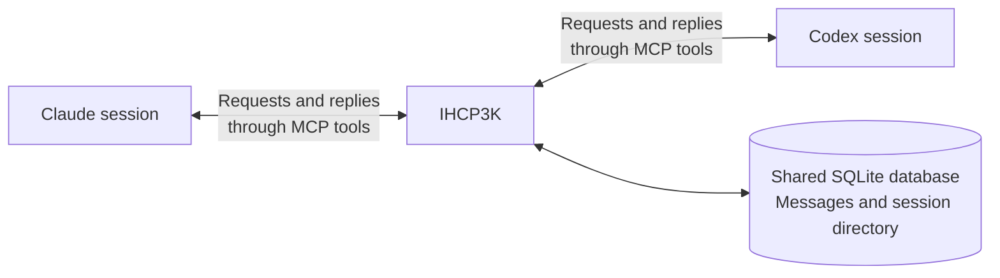

# Inter-Harness Communication Protocol 3000

**Your AI assistants, working together.**

Have subscriptions to Claude, Codex and GitHub Copilot? It's frustrating to hit the limit in one while another sits unused. Or to want another model's opinion without copying your conversation into a different app.

IHCP3K lets connected coding assistants exchange requests and results. Stay in your preferred **harness**—the app running your agent—and bring in another when you need it.

## Make better use of your subscriptions

Spread work across the subscriptions you already pay for. Keep planning a feature in Claude while a connected Codex session investigates a failing test:

> Use IHCP3K to ask the connected Codex session to investigate this failing test. Send it the failure output and relevant code, and bring the findings back here. Don't change files yet.

Approaching your allowance limit? Prepare a handover before it runs out:

> Prepare a handover for Codex with the goal, decisions, changed files, test results and next steps. Stop work here and ask it to confirm it can continue.

Each subscription keeps its own limits. IHCP3K shares requests and results; it doesn't pool allowances, clone chat history or automatically merge memories.

## Use the right model for the job

Your preferred app doesn't have to limit your choice of model. You might favour one model for implementation, another for architecture, and a third for reviewing a difficult change. IHCP3K lets you use those strengths across connected harnesses and bring the results back to the conversation you're already in.

For example, you can keep working in Codex and ask a connected harness that offers **Fabel 5.x** to review your design:

> Ask a connected session using Fabel 5.x to review this design for concurrency problems. Send it the design and relevant code, then bring its findings back here so we can implement the changes in Codex.

The work runs in the other harness, using its model access; Fabel doesn't need to be available inside Codex. Discovery helps find a suitable session. If none is using the requested model, the assistant explains what needs setting up before sending work.

Unsure which model to use?

> Show me the available models across my connected harnesses. Based on their recorded strengths, suggest one for reviewing this database migration and explain why.

You choose when to delegate. Ordinary prompts stay local; IHCP3K doesn't silently switch models or buy API credits.


*Mock conversation, not a product screenshot. Actual wording and tool displays vary by harness.*

## Get started

Give your assistant this prompt:

> Set up IHCP3K using https://github.com/GreyManSoftware/IHCP3K/blob/master/AGENT_SETUP.md. Ask only “Where do you want to install it?”, then connect my coding assistants and test a request and reply.

The prebuilt release needs an existing Node 24.15+ installation. Docker isn't needed to run it.

## Everyday usage

Register each harness once. Registration connects it reciprocally with the other registered harnesses in that installation. IHCP3K discovers its existing and future sessions automatically when you discover or send work—no setup per chat. Use the `harness-interop` skill:

| Mode | Purpose | Example |
| --- | --- | --- |
| `/register` | Connect a harness once. | `/register Codex` |
| `/discover` | List connected sessions or models. | `/discover models` |
| `/remote_prompt` | Send a request to another session. | `/remote_prompt Claude Ask the review agent to do ABC` |
| `/status` | Check a request's progress. | `/status <request-id>` |
| `/unregister` | Disconnect a harness. | `/unregister Codex` |

Name the harness you want to use; `Claude` names the harness; the skill resolves a suitable session using the request and project context. Unregistering a harness revokes its credential and all discovered session addresses; the skill also removes its IHCP3K connection settings. Other harnesses and shared data remain.

**Need help?** Use any mode on its own or add `--help`. The skill explains the arguments and shows examples before acting. `/remote_prompt` can also list available destinations. `/prompt` and `/chat` remain aliases.

These are skill instructions, **not universal native slash commands or typing-box autocomplete**. If your app intercepts `/` commands, use:

```text
Use harness-interop: /remote_prompt --help
Use harness-interop: /discover sessions
/remote_prompt Claude Ask the review agent to do ABC
```

The primary form is `/remote_prompt <harness> <request>`. If the app intercepts slash commands, prefix it with `Use harness-interop:`. The agent handles internal session addresses. See [all modes and terminal usage](docs/usage.md) for more.

## How it connects

Either session can send a request. The answer returns to the original conversation:



MCP (Model Context Protocol) exposes IHCP3K tools to each assistant. SQLite stores messages in a private local file, without a separate database server. [Automatic cleanup](docs/retention.md) expires completed history and enforces capacity limits without AI calls. Configured notifications alert the receiving session; if every runtime is closed, messages wait until one starts again.

**Version 1.2.0.** A Claude–Codex round trip was tested with the previous registration flow. The new harness-wide flow has automated coverage and verified native discovery; a fresh native install and delivery test remains. Automatic session discovery supports the installed Codex and Claude listing interfaces. Copilot discovery is not implemented; its notification adapter remains experimental. Other harnesses need compatibility checks; see [validation](docs/validation.md).

[Download](https://github.com/GreyManSoftware/IHCP3K/releases) · [Agent setup](AGENT_SETUP.md) · [Architecture](docs/architecture.md) · [Technical terms](docs/terminology.md)

Independent project; not affiliated with the harness vendors. License selection is pending.
