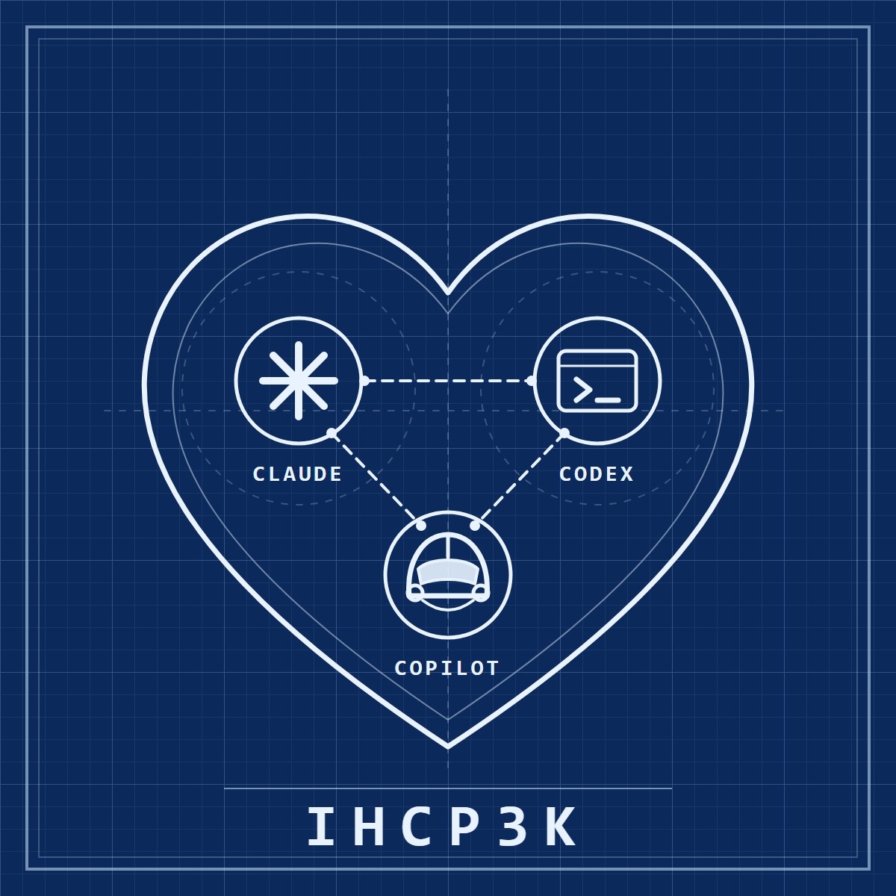
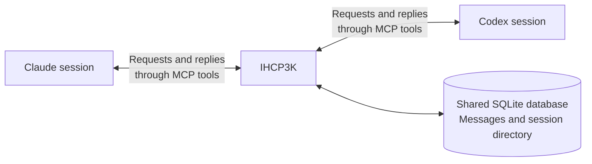

# Inter-Harness Communication Protocol 3000

<p align="center"></p>

**Your AI assistants, working together.**

Have subscriptions to Claude, Codex and GitHub Copilot? It's frustrating to hit the limit in one while another sits unused. Or to want another model's opinion without copying your conversation into a different app.

IHCP3K lets connected coding assistants exchange requests and results. Stay in your preferred **harness**—the app running your agent—and bring in another when you need it.

Tired of asking agents to write handoff Markdown files just to get help from another app? Ask directly: “Ask Claude to review this design and bring the answer back here.” Send the relevant context once, without creating a matching chat first.

## Make better use of your subscriptions

Spread work across the subscriptions you already pay for. Keep planning a feature in Claude while a connected Codex session investigates a failing test:

> Use IHCP3K to ask the connected Codex session to investigate this failing test. Send it the failure output and relevant code, and bring the findings back here. Don't change files yet.

Approaching your allowance limit? Prepare a handover before it runs out:

> Prepare a handover for Codex with the goal, decisions, changed files, test results and next steps. Stop work here and ask it to confirm it can continue.

Each subscription keeps its own limits. IHCP3K shares requests and results; it doesn't pool allowances, clone chat history or automatically merge memories.

## Use the right model for the job

Your preferred app doesn't have to limit your choice of model. You might favour one model for implementation, another for architecture, and a third for reviewing a difficult change. IHCP3K lets you use those strengths across connected harnesses and bring the results back to the conversation you're already in.

For example, you can keep working in Codex and ask a connected harness that offers **Fabel 5.x** to review your design:

> Ask a connected session using Fabel 5.x to review this design for concurrency problems. Send it the design and relevant code, then bring its findings back here so we can implement the changes in Codex.

The work runs in the other harness, using its model access; Fabel doesn't need to be available inside Codex. You can use an existing chat or ask for a one-off review with a specific model. If that model isn't available, IHCP3K reports the failure instead of switching models.

## Get help without an existing chat

No matching Claude or Codex session? Ask the connected harness to do the work directly:

> Ask Claude to review this function for race conditions. Use a new one-off session and return the findings here. Don't change files.

Or supply a project folder:

> /remote_prompt Codex In a new one-off session, review the code in /projects/example and suggest a simpler design.

IHCP3K starts one temporary worker that does the task and returns its answer to this conversation. It defaults to the install folder when no working folder is supplied. You can name a model; otherwise the harness uses its native default.

One-off workers currently support **read-only Claude and Codex tasks**, with a three-minute default timeout (up to five minutes). They don't inherit this conversation automatically: your assistant supplies the task and relevant context. They use nonpersistent native sessions; existing chats stay intact. File changes and other harnesses aren't supported by this one-off route yet.

Unsure which model to use?

> Show me the available models across my connected harnesses. Based on their recorded strengths, suggest one for reviewing this database migration and explain why.

You choose when to delegate. Ordinary prompts stay local; IHCP3K doesn't silently switch models or buy API credits.


*Mock conversation, not a product screenshot. Actual wording and tool displays vary by harness.*

## Get started

Give your assistant this prompt:

> Set up IHCP3K using https://github.com/GreyManSoftware/IHCP3K/blob/master/AGENT_SETUP.md. Ask only “Where do you want to install it?”, then connect my coding assistants and test a request and reply.

The prebuilt release needs an existing Node 24.15+ installation. Docker isn't needed to run it.

## Everyday usage

Register each harness once. Registration connects it reciprocally with the other registered harnesses in that installation. IHCP3K discovers its existing and future sessions automatically when you discover or send work—no setup per chat. Use the `harness-interop` skill:

| Mode | Purpose | Example |
| --- | --- | --- |
| `/register` | Connect a harness once. | `/register Codex` |
| `/discover` | List connected sessions or models. | `/discover models` |
| `/remote_prompt` | Ask an existing session or start one-off work. | `/remote_prompt Claude Review this design in a new one-off session` |
| `/status` | Check a request's progress. | `/status <request-id>` |
| `/update` | Update the runtime, shared skill and MCP connections. | `/update` |
| `/unregister` | Disconnect a harness. | `/unregister Codex` |

Name the harness you want to use; `Claude` names the harness. Name an existing chat when its history matters, or ask for one-off work when it doesn't. Unregistering a harness revokes its credential and all discovered session addresses; the skill also removes its IHCP3K connection settings. Other harnesses and shared data remain.

**Need help?** Add `--help` to any mode. Commands needing arguments also explain themselves when used on their own; `/update` is already a complete request. The skill explains the arguments and shows examples before acting. `/remote_prompt` can also list available destinations. `/prompt` and `/chat` remain aliases.

These are skill instructions, **not universal native slash commands or typing-box autocomplete**. If your app intercepts `/` commands, use:

```text
Use harness-interop: /remote_prompt --help
Use harness-interop: /discover sessions
/remote_prompt Claude Ask the review agent to do ABC
```

You can also ask in plain language:

> Ask Codex if \<Session\> knows about ABC.

> Ask Claude to have the review agent check this design.

Replace `<Session>` with the chat's name, for example: “Ask Codex if the backend session knows about the login timeout.” The skill finds the destination and brings the reply back here. No slash command needed.

The primary form is `/remote_prompt <harness> <request>`. If the app intercepts slash commands, prefix it with `Use harness-interop:`. The agent handles internal session addresses. See [all modes and terminal usage](docs/usage.md) for more.

## Updates

Say **“Update IHCP3K”** or `Use harness-interop: /update`. Your assistant checks the latest release, verifies it, preserves your data and registrations, updates the skill and refreshes MCP connections. You do not need to download, move files or run scripts yourself. Use `/update --check` to check without changing anything.

If an app needs restarting, the assistant asks first. An installed update is not reported as fully connected until the native connection is checked. See [update details](docs/updating.md).

## How it connects

Either session can send a request. The answer returns to the original conversation:



While waiting for an answer, replies can arrive inside the assistant's tool call. Claude can also use a background-task completion event. Idle Codex chats still receive a brief notification; the app controls how tools and events are displayed.

MCP (Model Context Protocol) exposes IHCP3K tools to each assistant. SQLite stores messages in a private local file, without a separate database server. [Automatic cleanup](docs/retention.md) expires completed history and enforces capacity limits without AI calls. Configured notifications alert the receiving session; if every runtime is closed, messages wait until one starts again.

Suspended Claude Desktop chats can be opened automatically before delivery, including when no chat is currently running. IHCP3K verifies the existing chat’s identity and excludes archived chats; it does not create a replacement. The Windows path has been tested. Desktop versions with an unfamiliar metadata layout need a compatible adapter; see [wake behavior](docs/native-adapters.md#unloaded-claude-desktop-targets).

**Version 1.5.0.** Automatic notifications and a request/reply round trip have been tested between installed Claude and Codex sessions. Setup includes notifications as standard. Automatic session discovery supports the installed Codex and Claude listing interfaces. Copilot discovery is not implemented; its notification adapter remains experimental. Other harnesses need compatibility checks; see [validation](docs/validation.md), including connection-reload and closed-app limits.

[Download](https://github.com/GreyManSoftware/IHCP3K/releases) · [Agent setup](AGENT_SETUP.md) · [Architecture](docs/architecture.md) · [Technical terms](docs/terminology.md)

Independent project; not affiliated with the harness vendors. License selection is pending.

See [native app updates and retained inboxes](docs/app-updates.md) for operator-pinned executable resolution, in-place configure/profile refresh, stale health and safe inbox access during failed discovery. Do not unregister or rotate credentials to repair a changed native executable.
