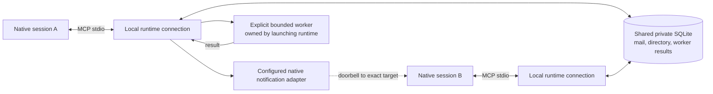

# IHCP3K

**Inter-Harness Communication Protocol 3000** lets AI sessions exchange durable requests and results across harnesses. Sessions can talk directly; a PA is optional.

**v0.5 candidate — implemented and locally tested; not published or cut over live.** Native harness validation remains limited. See [validation](docs/validation.md).

The default is local MCP over stdio, using an existing compatible Node runtime and one shared SQLite database in a private folder you choose. Docker builds the bundles; it is not required to run an already-built local installation. The optional Docker/HTTP deployment retains the existing v0.4 capabilities.



Runtime connections are not assumed to map one-to-one to chats. Each endpoint needs an explicit credential and native binding. A doorbell signals pending mail; it does not prove the recipient read or completed it.

## What the candidate adds

- Correlated requests and replies with explicit return endpoints and status.
- Multiple stdio connections sharing durable mail, claims and directory state.
- Configured native notifications: deterministic Codex queue; version-validated Claude Code messaging.
- Bounded workers with durable results and an explicit history/cleanup choice. Copilot workers and the documentation-based AHP notification adapter are experimental and untested against an installed host.

Plain prompts stay in the current session. IHCP3K does not silently route work, change models, pool subscription allowances or authorize paid fallback. Shared skills and project memory remain in user-chosen canonical locations.

## Set it up

Give your assistant [AGENT_SETUP.md](AGENT_SETUP.md) and the [harness-interop skill](skills/harness-interop/SKILL.md). **First install must ask where to put private runtime state before writing it.** Setup also records native bindings, model evidence, permissions and worker retention. Native configuration is prepared for explicit setup, never silently installed.

For a source checkout, use existing Node 24.15+ and Docker to build the bundles:

```sh
node scripts/dev.mjs prepare
```

Then follow [onboarding](docs/onboarding.md). Do not install a host runtime to satisfy a missing prerequisite. App-closed delivery and exact-time cleanup are not guaranteed; maintenance runs while a runtime is active.

[Architecture](docs/architecture.md) · [Protocol](docs/protocol.md) · [Native adapters](docs/native-adapters.md) · [Validation](docs/validation.md) · [Security](SECURITY.md)

License selection is pending. This independent project is not affiliated with the harness vendors.
