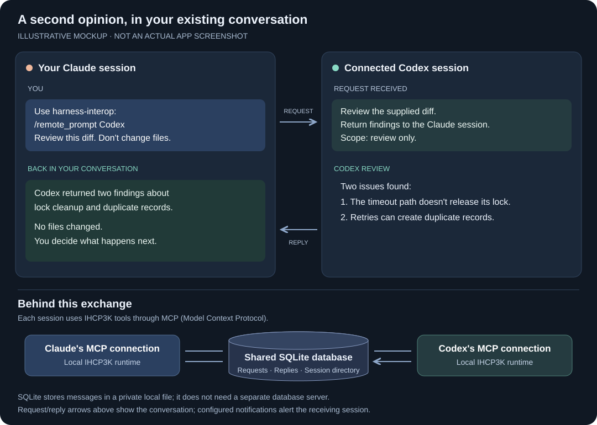
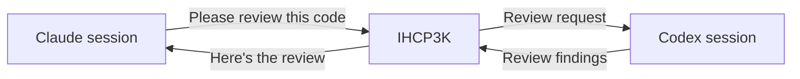

# Inter-Harness Communication Protocol 3000

**Your AI assistants, working together.**

Have subscriptions to Claude, Codex and GitHub Copilot? It's frustrating to hit the limit in one while another sits unused. Or to want another model's opinion without copying your conversation into a different app.

IHCP3K lets connected coding assistants exchange requests and results. Stay in your preferred **harness**—the app running your agent—and bring in another when you need it.

## Make better use of your subscriptions

Spread work across the subscriptions you already pay for. Keep planning a feature in Claude while a connected Codex session investigates a failing test:

> Use IHCP3K to ask the connected Codex session to investigate this failing test. Send it the failure output and relevant code, and bring the findings back here. Don't change files yet.

Approaching your allowance limit? Prepare a handover before it runs out:

> Prepare a handover for Codex with the goal, decisions, changed files, test results and next steps. Stop work here and ask it to confirm it can continue.

Each subscription keeps its own limits. IHCP3K shares requests and results; it doesn't pool allowances, clone chat history or automatically merge memories.

## Use models outside your current app

Ask a connected assistant for a fresh review, an alternative design or a focused investigation, then use its answer in your current conversation.

> Show me the models advertised by my connected harnesses and when that information was checked. Suggest one for reviewing this database migration, and let me choose before sending it.

You choose when to delegate. Ordinary prompts stay local; IHCP3K doesn't silently switch models or buy API credits.



*Mock conversation, not a product screenshot. Actual wording and tool displays vary by harness.*

## Get started

Give your assistant this prompt:

> Set up IHCP3K using https://github.com/GreyManSoftware/IHCP3K/blob/master/AGENT_SETUP.md. Ask me where to store its private working data, then help me connect my coding assistants and test a request and reply.

The prebuilt release needs an existing Node 24.15+ installation. Docker isn't needed to run it.

## Everyday usage

After setup, use the `harness-interop` skill:

| Mode | Purpose | Example |
| --- | --- | --- |
| `/register` | Connect a session. | `/register this session` |
| `/discover` | List connected sessions or models. | `/discover models` |
| `/remote_prompt` | Send a request to another session. | `/remote_prompt codex-review Review this diff` |
| `/status` | Check a request's progress. | `/status <request-id>` |
| `/unregister` | Disconnect a harness or session. | `/unregister harness Codex` |

Use a destination returned by `/discover`; `codex-review` is just an example. Unregistering a harness removes its verified registrations and IHCP3K connection settings, preserving other harnesses and shared data.

**Need help?** Use any mode on its own or add `--help`. The skill explains the arguments and shows examples before acting. `/remote_prompt` can also list available destinations. `/prompt` and `/chat` remain aliases.

These are skill instructions, **not universal native slash commands or typing-box autocomplete**. If your app intercepts `/` commands, use:

```text
Use harness-interop: /remote_prompt --help
Use harness-interop: /discover sessions
Use harness-interop: /remote_prompt codex-review Review the current diff
```

See [all modes and terminal usage](docs/usage.md) for more.

## How it connects

Either session can send a request. The answer returns to the original conversation:



Messages are stored locally. Configured notifications alert the receiving session; if every runtime is closed, messages wait until one starts again.

**Version 1.0.0.** A Claude–Codex round trip has been tested. Copilot support remains experimental and hasn't been tested against an installed host. Other harnesses need compatibility checks; see [validation](docs/validation.md).

[Download](https://github.com/GreyManSoftware/IHCP3K/releases) · [Agent setup](AGENT_SETUP.md) · [Architecture](docs/architecture.md) · [Technical terms](docs/terminology.md)

Independent project; not affiliated with the harness vendors. License selection is pending.
