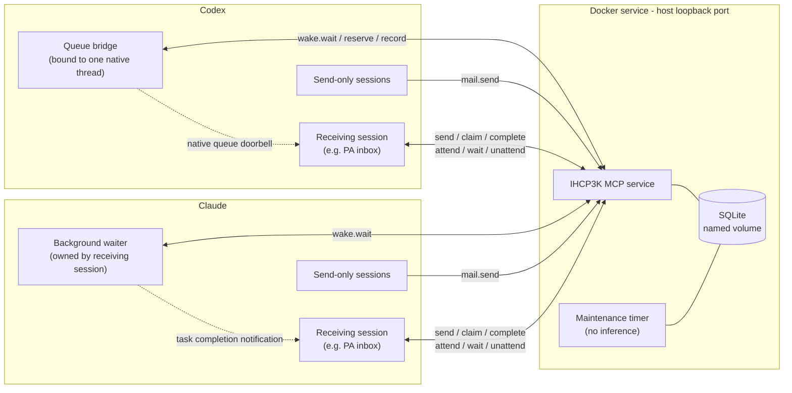

# Architecture

One local service owns the SQLite database and exposes scoped tools over standard MCP Streamable HTTP. Its Docker port is published only on the host's loopback address. Sessions connect with scoped credentials. Small harness-specific wake adapters turn "mail is pending" into a native notification for a receiver that is not actively waiting. Clients do not share the database file, and a notification never grants permission to act.

Harness-to-service edges are MCP calls with per-principal scopes; the internal lines show database access. Dashed edges are native harness notifications: best-effort hints, never message transport. Canonical skills, agent definitions and memory are files each harness reads directly. They are not stored in or synced by this service, so they are not in the diagram.

## Participants

- **Receiving session:** owns one inbox. It may claim, complete, release and attend only that inbox. The initializer creates one receiving inbox per harness, conventionally its PA. A PA is an optional coordination role, not something the service needs.
- **Send-only session:** can post to permitted inboxes, but cannot read, claim or suppress notifications.
- **Wake adapter:** one per receiving inbox, holding a wake/status credential. It is configured by hand with the receiver's native thread or hosting session. It calls `wake.wait`, never claims, and never reads message bodies.

Any endpoint configured with a permitted credential can communicate. Automatic session enrolment, a directory of sessions, and routing are future work.

## Two ways to receive

1. **Active receiver.** When awaiting a reply, the session calls `mail.attend` *before* sending, then `mail.wait` (which claims directly), then `mail.unattend`. The client's `exchange` helper wraps those steps. Attendance lasts up to 120 seconds and never renews itself. While it holds, the service withholds wake hints and new doorbell reservations for that inbox, so the reply needs no doorbell.
2. **Receiver not actively waiting.** The adapter's bounded `wake.wait` sees pending mail. The Codex bridge reserves a fenced notification (`wake.reserve`), queues a native doorbell and records `queued` or `uncertain` (`wake.record`). The Claude waiter instead exits, allowing its hosting harness to notify the session; the session must re-arm that waiter. Pending hints are throttled to one per 30 seconds per inbox, and Codex dispatches coalesce until claimed or reconciled. The receiver then claims through MCP. A busy native session may deliver its queued notification after the current turn.

**Limits:**

- A doorbell that was already reserved or queued can't be recalled by a later attendance.
- An uncertain dispatch waits for an administrator's `control.reset_wake`.
- A wake adapter lives only as long as its host process. If it runs inside another session, it stops when that session closes.
- Waking a closed or restarted app depends on the harness and isn't guaranteed.

## Delivery and ownership

- **Committing a message:** the message and its notification state commit together. Sender-scoped idempotency keys reject conflicting payloads.
- **Claims:** each claim carries a generation, an opaque token and a deadline, so completing or releasing a stale claim fails.
- **Restarts and expiry:** interrupted or expired claimed work goes to reconciliation; pending mail stays pending. Uncertain work is never repeated automatically.
- **Separate outcomes:** native enqueue, model receipt and completed work are three separate results.
- **One writer:** an SQLite ownership lock prevents a second service from writing.

## Cleanup

- **Completion:** clears the message body atomically, keeping the outcome and the duplicate identity.
- **Maintenance:** a bounded pass runs every minute. It reconciles expired claims and compacts outcome and audit detail older than 90 days.
- **Dedup identities:** these stay, so an old resend never becomes new work.
- **Pending and uncertain work:** pending mail awaits its receiver; uncertain work needs an administrator's resolution, with a reason and a generation check.
- **Not secure erasure:** logical deletion doesn't scrub the underlying bytes. Backup and restore must account for retained data and for possible replay after a rollback.

## Not implemented yet

- automatic session enrolment, directory and routing;
- a supported auto-start for wake adapters;
- reply correlation for each request (attendance covers the whole inbox);
- session mirrors and handover checkpoints;
- model discovery and routing;
- a resource scheduler (capacity-aware requests are a convention today, not a service feature).
