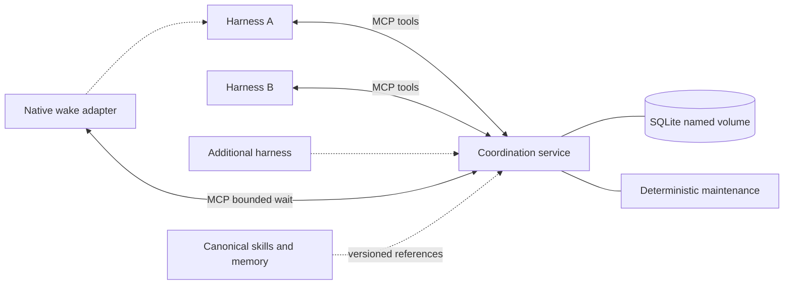

# Architecture

One local service owns the SQLite database and exposes tools through standard MCP Streamable HTTP. Harness-specific adapters call native mechanisms to notify sessions; they do not share the database file or manufacture permission to execute work.

Solid edges describe the service and clients. Native wake depends on the harness; knowledge and ownership integration remain future work. The service's timer performs maintenance without AI inference. A separate SQLite ownership lock prevents a second service writer and is released when the owning process exits.

## Delivery and ownership

Messages and notification state commit together. Sender-scoped idempotency keys reject conflicting payloads. Claims carry a generation, opaque token and deadline. Completing or releasing a stale claim fails. Process restart and claim expiry send uncertain work to reconciliation instead of automatically repeating it.

Native enqueue success, model receipt and completed work are separate outcomes. The outbox records notification hints and attempt counts. A separate fenced reservation coalesces Codex queue notifications and holds uncertain attempts for review. Automatic eventual delivery is not guaranteed across app closure or unresolved uncertainty; status exposes those conditions.

The Claude-compatible waiter uses a bundled official MCP client to wait for pending work. It never claims or reads bodies. A harness may use its process completion as a native notification, but that behavior depends on the host and is not implied by the MCP standard. Closed-session wake is unverified.

## Cleanup

- Completion atomically clears the message body and retains its outcome and duplicate identity.
- A minute-based bounded maintenance pass reconciles expired claims and compacts old outcome/audit detail after 90 days.
- Deduplication identities remain; deleting detailed receipts must not make an old resend executable again.
- Pending and uncertain work is retained. An administrator can explicitly reconcile it with a reason and generation check.
- Logical deletion is not secure erasure. A production backup/restore policy must account for retained bytes and possible replay after rollback.

## Shared knowledge and future work

Keep authored skills, agent definitions and project memory in one canonical source; generate only the harness-specific adapters. Runtime mail and handovers remain private. Planned session mirrors map logical work to native sessions, and handover requires a checkpoint, verified source stop and explicit destination acceptance.

Model discovery belongs in initial linking/re-linking. Preserve unknown capabilities and entitlement; use deterministic routing rules before asking a PA to resolve ambiguity. No paid fallback or model switch is implied by this repository.

Resource requests should include estimated/measured peak VRAM, GPU load, CPU threads and expected busy-core usage, RAM, duration and timing sensitivity. Shared capacity is the default; exclusive performance windows must be requested explicitly. None of this future coordination is an automatic scheduler in the current prototype.
