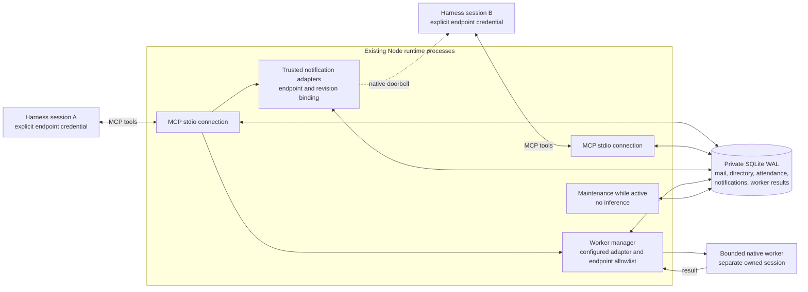

# Architecture

**v0.5 experimental prerelease; see the validation report for tested behavior.** Native adapter behavior remains subject to installed-version validation. The default runtime is local MCP stdio using an existing Node runtime. Compatible runtime connections share one private SQLite database. The database is the coordination authority; process identity is not chat identity.

The drawing shows logical components, not a guaranteed process count. Each stdio runtime has its own notification/worker managers and maintenance timers. Runtime clients may be shared or reused by a harness; credentials explicitly bind endpoints. Workers belong to the manager that launched them. Opening another connection does not adopt its children.

## State and concurrency

The shared schema stores mail, scoped directory entries, hashed credentials, request/reply links, attendance leases, native notification reservations and worker results. WAL transactions serialize mutations. Claim generations/tokens, endpoint revisions and notification reservations fence stale operations. A short database lease coordinates general maintenance across runtime processes; worker cleanup reserves eligible rows transactionally.

Compatible v0.5 processes may share the database. A writer-version fence rejects incompatible writes. The older Docker/HTTP store uses an exclusive owner lock; it must not run against the shared local authority. Installer reuse checks identity, schema and copied-bundle integrity. Installation does not authorize an upgrade or live migration.

A committed message survives process shutdown. Expired claims and uncertain notification/worker outcomes require reconciliation; they do not silently replay. Opening another stdio connection must not invalidate a valid claim held elsewhere. A completed message clears its body but retains duplicate protection.

## Requests and receiving

`mail.request` commits a request with the caller's explicit return endpoint, derived from its credential, and a stable request ID. `mail.reply` uses the request's fenced claim to commit one correlated reply and complete the request atomically. Claimed replies carry `in_reply_to`; `mail.request_status` reports message and reply state. A completed request record alone is not proof of a successful task: inspect the reply and actual outcome.

Receivers either check their inbox or register bounded attendance before waiting. Attendance is persisted with a deadline so other runtime processes suppress new doorbells for that inbox. It does not renew itself, and starting another connection does not drop it. Already queued notifications cannot be recalled. The legacy `exchange` helper still uses ordinary mail and can receive unrelated messages.

## Native notifications

`runtime.notifications` maps exact endpoints to trusted native configurations with `endpoint_revision`. An active runtime checks pending mail, reserves a durable notification and invokes the configured adapter. These checks do not call a model. The Claude notification adapter itself may use a bounded model worker; Codex uses its native queue directly. No PA relay is required.

In stdio, `mail.send`, `mail.request` and `mail.reply` commit first, then await the configured bounded notification before returning (`timeout_ms` capped at 30000, with bounded shutdown). The response includes `native_notification` dispatch status, never proof of target receipt. A one-shot CLI therefore attempts its configured nudge before closing. Mail stays durable if notification fails; retry only with the original idempotency key. The active-runtime timer remains for pending recovery. Notifications are disabled until explicitly configured.

- Codex queue acknowledgement establishes queuing only. Warnings and ambiguous output are uncertain.
- Claude Code `ListAgents`/`SendMessage` requires version-specific validation of the combined no-persist notification path and an unambiguous stable target. Its worker success does not prove target receipt.
- Copilot's documentation-based AHP notification adapter is experimental; installed-host access and behavior remain untested and may need changes.

Registration/profile data cannot authorize an executable. Refresh or relink changes the endpoint revision; the trusted notification binding must be reviewed and updated explicitly. An uncertain dispatch is inspected before administrator reset. Missing delivery leaves mail pending with a manual fallback; it never starts an implicit replacement session.

## Bounded workers

An explicit `worker.start` selects only a trusted `runtime.workers` entry whose `allow_endpoints` includes the caller. Native executables, models, cwd, permissions, persistence and limits are operator configuration, not prompt fields. Native worker sessions are separate from the requester and recipient.

SQLite owns job identity and bounded results; the launching runtime owns the child process. `worker.status` and `worker.wait` inspect the caller's job. `worker.ack` records that the result was received. The CLI `worker` helper keeps its connection open through bounded waits. Closing its stdio connection aborts its owned running jobs, whose outcomes may be uncertain. Durable records do not imply detached execution.

## Retention and shutdown

Maintenance runs while a runtime is active. When every runtime is closed, there is no notification delivery or timed cleanup; later runtime activity can resume eligible maintenance. No daemon or OS scheduler is installed implicitly.

Completed mail bodies are cleared; older outcome/audit detail is compacted and dedup identities remain. Pending and uncertain work is retained. Native history cleanup is separate: only configured persisted Codex workers support archive/delete in this candidate, after durable result acknowledgement and verified exit. Failed and uncertain jobs are not automatic cleanup candidates. Worker result records and backups have their own retention; native cleanup does not erase them.

No-persist, process exit, archive and delete are different outcomes. Immediate-child exit is not proof of descendant or remote-job exit. Neither logical deletion nor native cleanup promises zero residue or remote erasure.

## Optional HTTP and external knowledge

The [Docker/HTTP deployment](http-v04.md) retains the existing v0.4 capabilities with an exclusive database owner and explicit wake bridges. It does not gain stdio-only request/worker tools automatically. It is an alternative authority, never a parallel live copy of the same mail.

Canonical skills, agent definitions and project memory remain in user-chosen files outside protocol state. Native adapters reference those sources. IHCP3K does not sync them, replicate sessions, schedule shared CPU/GPU resources or route ordinary prompts. See [onboarding](onboarding.md), [native adapters](native-adapters.md) and [protocol](protocol.md).
